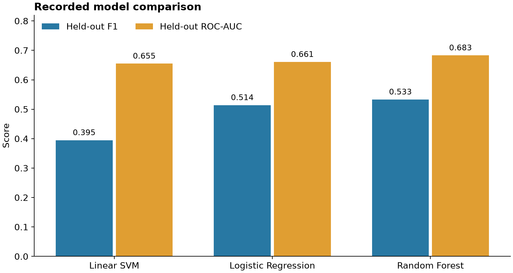
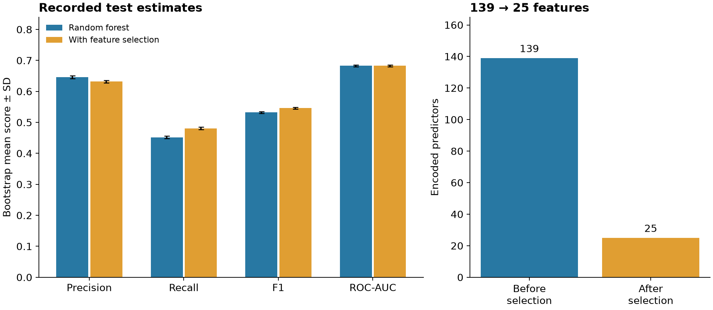
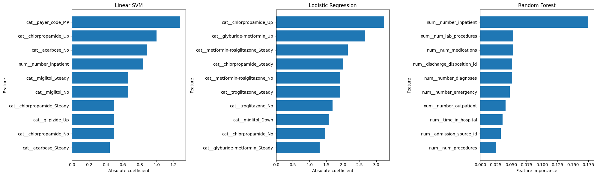

# Diabetes Readmission Prediction

Compare interpretable linear classifiers and random forests on hospital encounter records, then measure how model-based feature selection changes recall, F1, and dimensionality.

The outcome is **any recorded readmission**: both `<30` and `>30` map to the positive class; `NO` maps to the negative class. This is not a 30-day-only prediction problem. Each row is an encounter, not a unique patient.

## Workflow

1. Explore target balance, missing values, numerical distributions, and categorical cardinality.
2. Create an encounter-level stratified split with a fixed seed: 25,441 training encounters, 25,442 test encounters, and half of the original data unused for computational efficiency.
3. Remove identifiers and columns with over 40% missingness in the outer training set; group diagnosis codes into nine broader categories.
4. Fit median imputation and scaling for numerical predictors, and mode imputation plus one-hot encoding for categorical predictors, inside classification pipelines.
5. Tune linear SVM, logistic regression, and random forest with three-fold stratified grid search, selecting by mean F1.
6. Interpret coefficients, tree importance, training-set permutation importance, and overlap between top features.
7. Add random-forest-based `SelectFromModel`, tune its threshold within CV, and compare fixed-model bootstrap test estimates.

## Recorded results

These values are preserved from existing experiment outputs, not rerun full-data measurements from packaging.

| Model | Mean CV F1 | Held-out F1 | Held-out ROC-AUC |
| --- | ---: | ---: | ---: |
| Linear SVM | 0.3927 | 0.3948 | 0.6549 |
| Logistic regression | 0.5133 | 0.5138 | 0.6606 |
| Random forest | 0.5294 | 0.5330 | 0.6829 |



The feature-selection comparison uses **bootstrap means on the same held-out set**, rather than the single held-out scores above:

| Random forest pipeline | Encoded features | Bootstrap mean recall | Bootstrap mean F1 | Bootstrap mean ROC-AUC |
| --- | ---: | ---: | ---: | ---: |
| All predictors after preprocessing | 139 | 0.452 | 0.532 | 0.683 |
| With feature selection | 25 | 0.481 | 0.546 | 0.683 |

The recorded result trades some precision and accuracy for higher recall and F1 while reducing encoded features by approximately 82%. The rounded ROC-AUC values are the same; they do not establish statistical equivalence or a significant improvement.



See [recorded result tables](results/README.md) for sources, rounding, uncertainty, and the distinction between single test scores and bootstrap means.

## Run the notebook

Python 3.10 or newer is recommended. From this repository's root:

```bash
python3 -m venv .venv
source .venv/bin/activate
python -m pip install -r requirements.txt
python -m jupyter lab diabetes_readmission.ipynb
```

Open the notebook and select **Restart Kernel and Run All Cells**. The dataset is included under `data/`, so no Google Drive mount or private path is required. Full mode retains the original data fractions, model grids, three CV folds, five permutation repeats, and 100 bootstrap resamples; the linear SVM search can take appreciable time.

For a faster infrastructure check:

```bash
DIABETES_SMOKE_TEST=1 python -m jupyter lab diabetes_readmission.ipynb
```

Start this command after stopping any existing Jupyter server, then run all cells from a fresh kernel. Smoke mode uses 1,200 training and 800 test encounters, one candidate per model, two permutation repeats, and five bootstrap resamples. Its scores are not comparable to the recorded full experiment. Clearing the environment flag and restarting the kernel restores full mode.

## Model interpretation

The original model plots are retained as recorded artifacts. Linear classifiers emphasise different encoded categories, while the random forest places more weight on healthcare-utilisation variables. Feature importance describes associations in fitted models, not causal effects.



## Evaluation limits

- The split is by encounter. The same patient may occur in training, CV validation, and test sets; dropping `patient_nbr` as a predictor does not prevent this overlap. This is not evidence of generalisation to unseen patients.
- Missingness-based column removal is selected once on the outer training set, outside inner CV. Imputation, encoding, scaling, and the feature selector are fitted inside CV pipelines, but not every preprocessing decision is fold-local.
- Admission and discharge codes keep their original numeric treatment. Diagnosis grouping is a simplified mapping, and missing diagnoses follow the preserved mapping to `other`.
- Permutation importance uses training data. It is not an independent assessment of feature value.
- Bootstrap standard deviations measure resampling variation for fixed fitted models, not variation from retraining, patient-level resampling, or multiple independent experiments.
- Patient-grouped validation, temporal validation, calibration, subgroup evaluation, and prospective clinical testing have not been performed. This repository presents a retrospective classification analysis.

Details: [evaluation notes](docs/evaluation.md), [packaging changes](docs/changes.md), and [validation scope](docs/validation.md).

## Data and attribution

The included CSV has 101,766 encounters and 50 columns, including the target and two identifiers; these are not 50 independent predictors. There are 71,518 distinct patient identifiers. Source: [Diabetes 130-US Hospitals for Years 1999-2008, UCI Machine Learning Repository](https://archive.ics.uci.edu/dataset/296/diabetes+130-us+hospitals+for+years+1999-2008).

Clore, J., Cios, K., DeShazo, J., and Strack, B. (2014). *Diabetes 130-US Hospitals for Years 1999-2008* [Dataset]. https://doi.org/10.24432/C5230J.

The provider lists the dataset under [CC BY 4.0](https://creativecommons.org/licenses/by/4.0/). The two included CSV files are unmodified; see [data attribution](data/README.md). Dataset terms apply to the data and do not grant a blanket license to every repository artifact.

## Repository layout

```text
diabetes-readmission-prediction/
├── README.md
├── diabetes_readmission.ipynb   # main analysis, run top to bottom
├── requirements.txt
├── .gitignore
├── data/                       # CSV inputs and attribution
├── figures/                    # recorded plots and result summaries
├── results/                    # historical metrics in CSV format
├── docs/                       # interpretation, changes, validation
└── scripts/                    # regenerate recorded-result charts
```

Python · pandas · NumPy · scikit-learn · Matplotlib · Jupyter.
